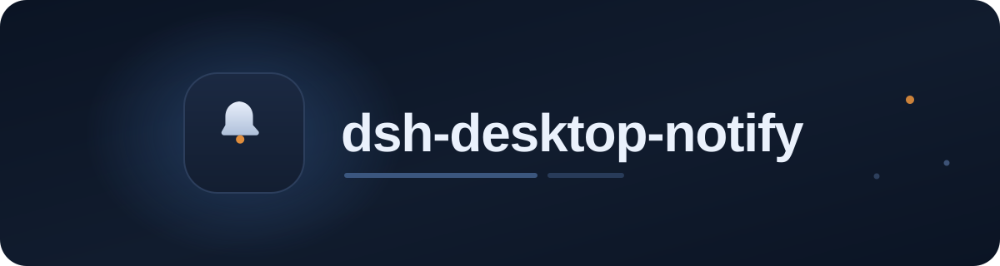
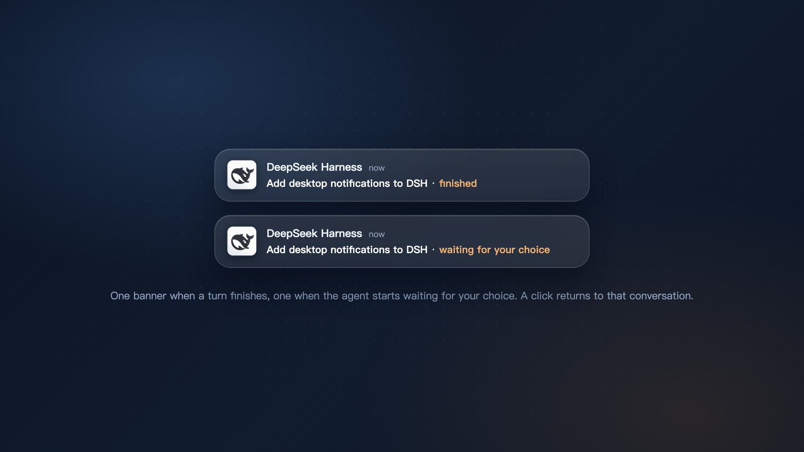

<!-- README_SYNC: source=working-tree; updated=2026-11-18 -->

<p align="center">
  <a href="./README_CN.md">简体中文</a> · English
</p>

<div align="center">



<h1>dsh-desktop-notify</h1>

<p><strong>DeepSeek Harness sessions run in the background. The plugin reports the two moments that need you: the turn finished, or the agent is waiting for your choice.</strong></p>

<p>
  <a href="https://github.com/chengzhi43/dsh-desktop-notify/stargazers"></a>
  <a href="https://github.com/chengzhi43/dsh-desktop-notify/releases/latest"></a>
  <a href="https://github.com/chengzhi43/dsh-desktop-notify/actions/workflows/checks.yml"></a>
  <a href="./LICENSE"></a>
  <a href="https://github.com/chengzhi43/dsh-desktop-notify/issues"></a>
  <a href="https://github.com/chengzhi43/dsh-desktop-notify/commits/main"></a>
  
  <a href="https://github.com/deepseek-ai/deepseek-harness"></a>
</p>

<p>A star helps the next person who needs this plugin find it.</p>

</div>

A session commonly runs for several minutes. While the window is in the background, two events matter: the turn finishes, or the agent stops and waits for an answer. The plugin delivers both through the system notification center, and a click returns to that conversation. A notification the user has not come back for is also counted on the app icon, so a glance at the Dock shows how many conversations are waiting.

It is a client-side bundle: one directory, no dependencies, no build step, no network requests, and nothing written to disk.

## Screenshots

<p align="center">
  
</p>

The plugin's whole output is these two notifications — a turn finished, and the agent starting to wait for your choice. The title stays `DeepSeek Harness`; the body is `<conversation> · <state>`.

## Notification content

| Event | Body | Click |
| --- | --- | --- |
| A turn finishes | `<conversation> · finished` | Opens that conversation |
| A question, approval, plan review, or action card starts waiting | `<conversation> · waiting for your choice` | Opens that conversation |

The title is always `DeepSeek Harness`; the body carries the conversation name and the state. The state text follows the application language, currently eight of them. Subagent conversations are excluded, and a pending request that is published again does not produce a second notification.

## App-icon badge

While the window is in the background, every conversation holding an unseen notification adds one to the app icon: a numbered Dock badge on macOS, a taskbar overlay on Windows, a launcher badge on Linux. Two conversations waiting show `2`. A second notification for the same conversation replaces the first instead of stacking, so the number always matches the notifications on screen.

The badge clears when the window comes back — the window gaining focus, or a click on a notification — because nothing is unseen at that point. The carrier is the standard Badging API (`navigator.setAppBadge` and `navigator.clearAppBadge`), which Electron maps onto the application icon. A Client without that API keeps its notifications and simply carries no badge.

Nothing is counted while the window has your attention, and no counter outlives the window: the plugin holds the set in memory and writes nothing to disk.

## Install

Two methods are available. Either one produces the same plugin directory.

### Option 1: install from the index link

1. In DSH, open **Plugins → Discover → Add index source**.
2. Paste the index URL:

```text
https://raw.githubusercontent.com/chengzhi43/dsh-desktop-notify/main/index.json
```

3. The list now contains `dsh-desktop-notify`. Choose Install. Every entry pins a commit, so the installed files match the listed version.
4. Allow notifications in the system settings, as described below.

The index file can be inspected directly at [index.json](https://raw.githubusercontent.com/chengzhi43/dsh-desktop-notify/main/index.json).

### Option 2: install from the bundle directory

1. Download `dsh-desktop-notify.zip` from the [latest release](https://github.com/chengzhi43/dsh-desktop-notify/releases/latest).
2. Unzip it into a directory that can remain in place.
3. In DSH, open **Plugins → Add plugin** and select that directory. Its root must contain `package.json`.
4. Reload the window with `Cmd/Ctrl + R`.

For both methods, the operating system must permit notifications from the application: macOS **System Settings → Notifications → DeepSeek Harness**, Windows **Settings → System → Notifications**.

Platform verification, including the open Windows toast question, is recorded in [docs/WINDOWS-VERIFICATION.md](./docs/WINDOWS-VERIFICATION.md).

## How it works

```text
DSH client (open page)
  uiSession.sessionStatus          running + highest-precedence pending interaction
    dsh-desktop-notify             diff one snapshot against the previous one
      Notification                 "<title> · finished" / "<title> · waiting for your choice"
        click                      uiWorkspace.openSession(sessionId)
      navigator.setAppBadge(n)     n conversations unseen while the window is away
        focus / visibilitychange   navigator.clearAppBadge()
  fallback: sessions.list          running state only, completions still announced
```

The plugin keeps a small map in memory and compares each snapshot with the previous one. A `running` value that changes from true to false indicates a finished turn; a new pending-interaction key indicates that the application expects an answer. No state is persisted, and unloading the bundle removes the subscription.

The state it reads is the one the application already publishes, the same source behind the sidebar indicator and the pending panel in the composer. Approval prompts and plan reviews are covered for that reason: they share this status, so no separate handling is required.

## Requirements and limits

- DeepSeek Harness desktop 0.2.2-rc.3 or newer. That is the release this plugin was developed and verified on, and the bundled runtime reports the same version. Earlier builds have not been tested; a build without `uiSession.sessionStatus` falls back to the conversation list and then reports completions only, without the waiting state.
- Notifications originate from the open page. When the window is closed or the application quits, no notification is delivered, although the session continues to run on the host.
- There is no sound setting, no per-conversation mute, and no quiet hours. A pending request notifies once, and repeated publication of the same state stays silent.
- On Linux, delivery depends on the desktop notification service and on whether it reports clicks back to Electron.
- The badge needs an icon to draw on. Inside the desktop app Electron maps it to the Dock badge, the Windows taskbar
  overlay, or the Linux launcher badge; macOS additionally requires notification permission before the badge renders.
- In a browser tab, the first notification passes through the browser permission prompt.
- On Windows, a window minimized to the tray may not come forward on click. Raising it requires a `dsh://open` call, which this plugin does not make.
- The plugin adds no model-facing text, sends no telemetry, and reads no credentials.

## Local verification

```bash
git clone https://github.com/chengzhi43/dsh-desktop-notify.git
cd dsh-desktop-notify
node --check client.js
node test/harness.cjs
```

The harness replaces the client services with stubs, so it runs without a DOM, Electron, or DSH. It covers completion, pending choice, duplicate suppression, subagent exclusion, click navigation, badge counting and clearing, teardown, and both degraded paths. CI runs the same commands on Linux and validates the index file; see [.github/workflows/checks.yml](./.github/workflows/checks.yml).

## Contributing

Issues in Chinese or English are both acceptable. For code changes: keep the bundle dependency-free and client-side, keep the status comparison as the only source of state, and add an entry to [CHANGELOG.md](./CHANGELOG.md). A new kind of notification usually means the application gained a new pending interaction rather than that this plugin needs more code.

## License

[MIT](./LICENSE). Use, fork, and redistribute it inside your own setup.

If the plugin is useful: star the repository, watch releases for updates, and open an issue when a notification is missing or repeatedly noisy.
